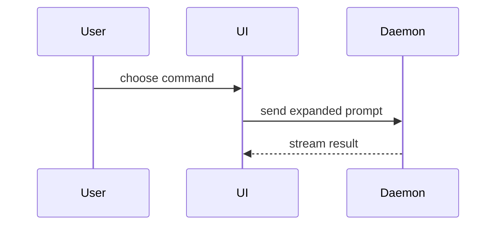

# Create PR

Commit the task changes, push the branch, and create a pull request.

## Navigation

```text
Create the pull request
├─ Inspect and publish the branch       → Steps
├─ Choose the smallest reviewer view   → Evidence selection
├─ Explain runtime or state flow        → Change-shape evidence
├─ Prove the change works               → Proof
└─ Confirm the remote result            → Final verification
```

## Steps

1. Confirm the repository, worktree, branch, HEAD SHA, and remote.
2. Run `git status` and preserve unrelated user changes.
3. Run `git diff` to understand the task changes.
4. Run `git log` to see the commit message style.
5. Run the repository quality gate.
6. Gather the proof (§Proof). Without it, stop here: no PR opens.
7. Stage only the task changes.
8. Commit with a concise Conventional Commit message.
9. Push the branch to the remote with `-u`.
10. Create the pull request with `gh pr create`, ready for review (no `--draft`).
11. Select the smallest reviewer view that explains each important change.
12. Add change-shape evidence when the change affects runtime flow, state, ownership, or module boundaries.
13. Embed the proof in the PR body (§Proof).
14. Apply each requested person to each requested assignee and reviewer role.

## PR Body Format

```
## Problem / Intent

[Why this change exists - the problem being solved or feature being added]

## Approach

[High-level concept of the solution - not a list of file changes]

## Scope

[1-3 items: what it covers, and what it deliberately leaves out (a follow-up, a known gap)]

## Tradeoffs

[Optional. Only the rejected alternatives a reviewer would otherwise ask about]

## Proof

[Required. The video, screenshots or red-on-base runs from §Proof, each under the claim it proves. Then **Unproven:** anything that could not be proven here, or "none".]

## Merge Danger

**Door:** [one-way or two-way], [why]
**Blast radius:** [one word], [who or what it touches, and why that is safe or risky]

## Review Guide

[Optional. Add only the smallest diagrams or shape diffs needed to understand the important change.]
```

## Rules

- PR title should be succinct (no "feat:" prefix, but "fix:" is ok for bug fixes)
- Do NOT include a summary of code changes or files modified
- Do NOT include a test plan with checkboxes
- Do NOT include "Generated with Claude Code" or similar footers
- Keep the PR description concise and focused on intent and approach
- Omit the review guide when prose already makes the change clear
- Omit Tradeoffs when there was no real choice
- Merge Danger: a two-way door rolls back cheaply; a one-way door does not (a destructive migration, a published or stored format, deleted data, an external send)
- Use HEREDOC for the PR body to preserve formatting

## Evidence Selection

Pick the smallest view that makes the important change clear. Use several views only when each view answers a different review question.

| Review question | Use |
| --- | --- |
| What logic or order changed? | Short pseudocode or state-flow diff |
| Which functions call each other? | Call tree or call-tree diff |
| Which component owns the state or action? | Component tree or component-tree diff |
| Which module owns each responsibility? | Shallow file tree or file-tree diff |
| How do several processes or services interact? | Mermaid sequence or flow diagram |
| What changed inside a known shape? | Focused `diff` block |
| Is most of the target shape new? | One complete, copyable block |
| What does the user now see? | Video of the journey plus before-and-after screenshots (§Proof) |

Apply these rules:

- Keep only the calls, files, props, states, and boundaries needed for review.
- Put each view next to the short text that it supports.
- Use real names and paths from the final code.
- Use `diff` when the existing shape gives useful context.
- Show the complete block when omitted context would hide ownership or order.
- Do not add every evidence type.
- Do not create a standalone HTML artifact for a pull request. Use GitHub-rendered Markdown, Mermaid, or stable images.

## Change-Shape Evidence

Add numbered inline review-guide comments at key changed lines. State the local callgraph change in each comment.

Use a compact shape in the PR body when reviewers need a broad map. Use an inline comment when the evidence explains one changed line.

### Shape examples

Logic or state flow:

```diff
 on(save)
-  write content
+  if content is unchanged
+    return cached result
   write content
+  invalidate cache
```

Call flow:

```diff
 submitForm
   createSession
     persistPrompt
+    expandSkillMention
     launchAgent
   navigateToSession
+    subscribeToEvents
```

Component ownership:

```diff
 <SessionPage> (apps/example/src/routes/session.tsx)
   useSessionEvents()
   <SessionToolbar>
+    <RunSkillButton /> (packages/ui)
   <SessionTimeline>
+    <SkillResultCard />
```

File responsibility:

```diff
 src/
 ├── commands/
+│   └── show-me.ts       # expands the command
 ├── sessions/
-└── transport.ts
+└── transport/
+    ├── client.ts
+    └── stream.ts
```

Multi-system interaction:



### Function and component callgraphs

1. Read the PR base SHA and head SHA from GitHub.
2. Fetch the base SHA when a shallow worktree does not contain it.
3. Run a focused callgraph diff for each important entry point.

```bash
bunx https://github.com/tanishqkancharla/calldiff diff <base-sha> <head-sha> \
  --entry <entry-point> --max-depth 3 -- <changed-paths>
```

If the GitHub package has no built executable, use `bunx calldiff@latest`. Verify that its version matches the inspected GitHub source.

Keep the useful `+` and `-` lines. Remove unrelated expansion. Put the reduced ASCII diff in the inline comment.

Use a manual component tree when ownership, props, or state are clearer than a function callgraph. Include the source path only where it helps reviewers locate the boundary.

### XState machines

`calldiff` does not describe declarative machine configuration. Read the exact machine diff. Add a small ASCII transition diff next to the changed state or event.

```diff
  ExistingState
+ └─ NewEvent(payload)
+    ├─ assign context.value
+    └─ NewState
+       ├─ Done
+       │  └─ ExistingState
+       └─ Quit
+          └─ Resetting
```

Show new and removed states, events, guards, actions, and context assignments. Use `+` and `-` markers. Do not invent paths that the machine does not contain.

Skip change-shape evidence for text-only or configuration-only changes with no meaningful runtime, state, ownership, or module-boundary change.

## Proof

A PR proves, beyond doubt, that the change does what it claims, on the head commit, in the running product. Proof comes before `gh pr create`. A change with no proof does not get a PR: go get the proof.

| Change | Proof |
| --- | --- |
| Anything a user sees or does | A video of the real journey on the head commit, plus a screenshot of each changed state, before and after. Drive it through the repo's `verify-<app>` skill where one exists. |
| Behavior with no screen (API, job, CLI, library) | The real run's output: the request and response, the command and its exit code, the rows written. Plus a check that is red on the base commit and green on head. |
| A bug fix | The failing run on base, and the same run passing on head. |
| Performance | The measured numbers, base and head, from the same harness and host. |
| Docs, config or refactor with no behavior change | The gate, and for a refactor, the unchanged results of the checks that cover the moved code. |

Rules:

- **The real product.** Proof comes from the running app or a real execution, never from a mock or a test that only exercises the mock.
- **Every changed path.** Each user-visible state, entry point and branch the change touches has its own proof. A proof of one convenient path does not cover the others.
- **Head commit.** Capture after the last code change. Recapture when a later commit changes behavior.
- **Hosting.** Upload media where every PR viewer can open it: GitHub attachments where available, else a dedicated PR asset branch (keep assets out of the product diff). Embed screenshots inline and link each video. Never a local or temporary path.
- **Live check.** Open the posted PR body and confirm every image renders and every video link plays.

When a piece of proof is genuinely impossible on this machine (a payment terminal, a printer, a production-only integration), name it under **Unproven** in the PR body with what was tried and what the reviewer must check, and say so in the report. Everything that can be proven here is proven first.

## Final Verification

After all external changes:

1. Re-read the live PR body.
2. Verify each image URL and rendered image.
3. Verify assignees and requested reviewers.
4. Verify numbered review-guide comments.
5. Verify that each diagram matches the final code and renders on GitHub.
6. Verify the local SHA, remote SHA, and PR head SHA.
7. Treat automation commits as remote changes. Inspect them before a fast-forward.
8. Report pending CI as pending. Do not call the PR green from partial evidence.
