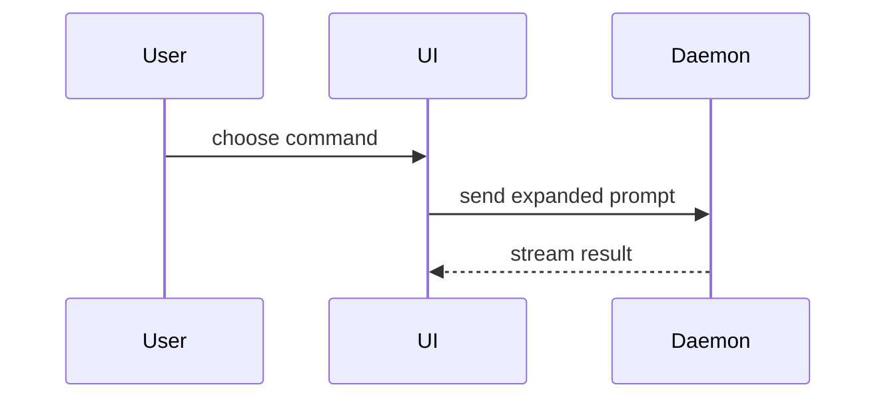

# Shape examples

Views for the PR body and guide comments, one per kind of change.

Logic or state flow:

```diff
 on(save)
-  write content
+  if content is unchanged
+    return cached result
   write content
+  invalidate cache
```

Call flow:

```diff
 submitForm
   createSession
     persistPrompt
+    expandSkillMention
     launchAgent
   navigateToSession
+    subscribeToEvents
```

Component ownership:

```diff
 <SessionPage> (apps/example/src/routes/session.tsx)
   useSessionEvents()
   <SessionToolbar>
+    <RunSkillButton /> (packages/ui)
   <SessionTimeline>
+    <SkillResultCard />
```

File responsibility:

```diff
 src/
 ├── commands/
+│   └── show-me.ts       # expands the command
 ├── sessions/
-└── transport.ts
+└── transport/
+    ├── client.ts
+    └── stream.ts
```

Multi-system interaction:


